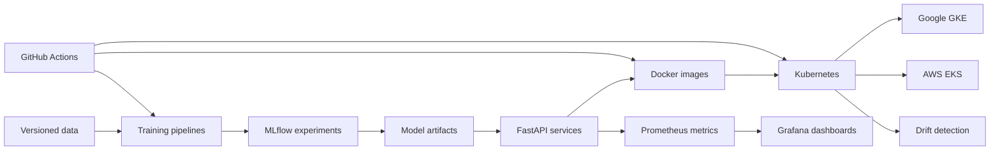

# StockOps

**Production ML systems with reproducible training, FastAPI inference, multi-cloud deployment, and end-to-end observability.**

[](https://github.com/AnirudhVermaCoding/StockOps/actions/workflows/ci-mlops.yml)
[](https://www.python.org/)
[](https://fastapi.tiangolo.com/)
[](https://kubernetes.io/)
[](LICENSE)

Maintained and customized by **Anirudh Verma** ([@AnirudhVermaCoding](https://github.com/AnirudhVermaCoding)).

## Overview

StockOps demonstrates how machine-learning models move beyond notebooks and become reliable services. It combines three ML use cases with model tracking, API serving, containerization, cloud infrastructure, automated delivery, monitoring, and drift detection.

The repository focuses on the operational side of ML:

- reproducible data and model pipelines;
- low-latency REST inference;
- automated testing and deployment;
- Kubernetes scaling and reliability;
- latency, error, resource, and drift monitoring;
- repeatable infrastructure on AWS and Google Cloud.

## ML services

| Service | Problem | Model | Result |
|---|---|---|---|
| **BankChurn Predictor** | Identify customers likely to leave a bank | Stacking ensemble | **0.87 AUC** |
| **NLPInsight Analyzer** | Classify sentiment in financial text | TF-IDF + Logistic Regression | **80.6% accuracy** |
| **ChicagoTaxi Pipeline** | Forecast hourly taxi demand | Random Forest with lag features | **0.96 R²** |

## System architecture



### ML lifecycle

1. **Validate and version data** with Pandera and DVC.
2. **Train and compare models** while recording experiments in MLflow.
3. **Expose predictions** through validated FastAPI endpoints.
4. **Package services** as secure, non-root Docker containers.
5. **Provision infrastructure** with Terraform.
6. **Deploy and scale** on GKE or EKS with Kubernetes and Kustomize.
7. **Observe production behavior** with Prometheus, Grafana, Locust, and Evidently.

## Engineering results

- Reduced inference load-test failures from **81% to 0%** by moving CPU-bound prediction work into an asynchronous `ThreadPoolExecutor` path.
- Achieved approximately **110 ms p50 latency** for BankChurn predictions on both GKE and EKS.
- Maintained **0% failures** for the primary inference services during documented multi-cloud load tests.
- Added **395+ automated tests** with 90–98% coverage across the three applications.
- Implemented CPU-based Kubernetes autoscaling, health probes, Pod Disruption Budgets, and drift-detection jobs.

The cloud environments were deployed and verified during controlled test windows. They are not kept online continuously to avoid unnecessary infrastructure cost.

## Technology stack

| Area | Tools |
|---|---|
| Machine learning | scikit-learn, XGBoost, LightGBM, PySpark, Dask, SHAP |
| MLOps | MLflow, DVC, Evidently, Pandera |
| Serving | FastAPI, Pydantic, Uvicorn |
| Infrastructure | Docker, Kubernetes, Helm, Kustomize, Terraform |
| Cloud | Google GKE/GCS/Artifact Registry, AWS EKS/S3/ECR |
| Observability | Prometheus, Grafana, Locust |
| Delivery | GitHub Actions, pytest, Codecov, Trivy, Bandit, Gitleaks |

## Run locally

### Requirements

- Git and Git LFS
- Docker Desktop with Docker Compose
- At least 8 GB of available memory

### Start the complete demo

```bash
git clone https://github.com/AnirudhVermaCoding/StockOps.git
cd StockOps

bash scripts/setup_demo_models.sh
docker compose -f docker-compose.demo.yml up -d --build
bash scripts/run_demo_tests.sh
```

### Local endpoints

| Component | Address |
|---|---|
| BankChurn API | http://localhost:8001/docs |
| NLPInsight API | http://localhost:8003/docs |
| ChicagoTaxi API | http://localhost:8004/docs |
| MLflow | http://localhost:5000 |

### Example API request

```bash
curl -X POST "http://localhost:8001/predict" \
  -H "Content-Type: application/json" \
  -d '{
    "CreditScore": 650,
    "Geography": "France",
    "Gender": "Female",
    "Age": 40,
    "Tenure": 3,
    "Balance": 60000,
    "NumOfProducts": 2,
    "HasCrCard": 1,
    "IsActiveMember": 1,
    "EstimatedSalary": 50000
  }'
```

## Repository structure

```text
StockOps/
├── BankChurn-Predictor/           # Classification service
├── NLPInsight-Analyzer/           # Financial sentiment service
├── ChicagoTaxi-Demand-Pipeline/   # Demand forecasting pipeline
├── infra/                         # Terraform and observability configuration
├── k8s/                           # Kubernetes base and cloud overlays
├── helm/                          # Helm chart
├── scripts/                       # Training, testing, and deployment utilities
├── tests/                         # Integration, infrastructure, and load tests
├── docs/                          # Architecture decisions and technical evidence
└── .github/workflows/             # CI/CD pipelines
```

## Documentation

- [Quick-start guide](QUICK_START.md)
- [Deployment evidence](docs/DEPLOYMENT_EVIDENCE.md)
- [Engineering highlights](ENGINEERING_HIGHLIGHTS.md)
- [Architecture](docs/ARCHITECTURE_PORTFOLIO.md)
- [Operations runbook](RUNBOOK.md)
- [Security policy](SECURITY.md)

## Maintainer

**Anirudh Verma**

GitHub: [@AnirudhVermaCoding](https://github.com/AnirudhVermaCoding)

## Attribution

StockOps is maintained as an adaptation of the open-source [ML-MLOps-Portfolio](https://github.com/DuqueOM/ML-MLOps-Portfolio) created by Duque Ortega Mutis. The original copyright notice is preserved in accordance with the MIT License.

## License

This project is distributed under the [MIT License](LICENSE).
